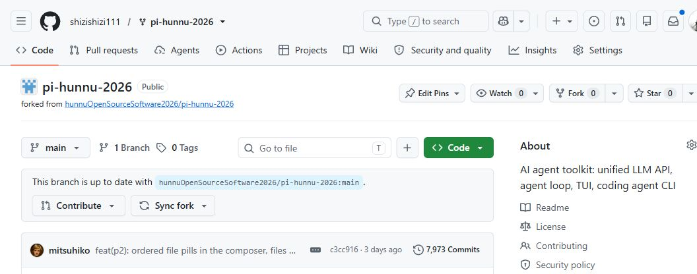
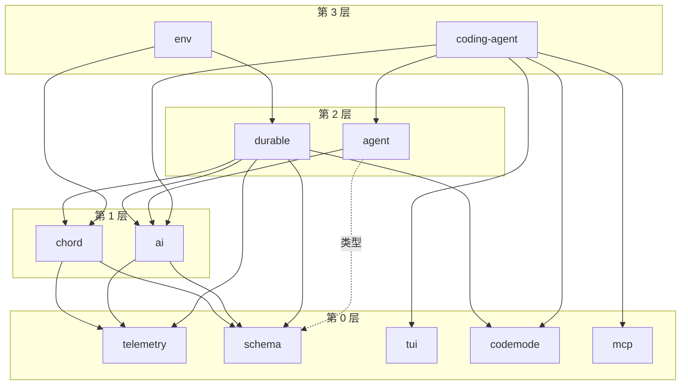

# 实践课 2：组织建仓与 Pi Agent 源码分析

姓名拼音 `yuanshiwen` · GitHub `shizi-shizi`

本报告以本地克隆的固定提交为依据，覆盖根构建脚本列出的 11 个模块。重点分析 `coding-agent`、`agent`、`ai` 和 `schema`，沿工具调用链说明各模块的分工。

## 1. 小组仓库与源码获取

| 检查项 | 结果 |
| --- | --- |
| 小组组织仓库 | [`shizishizi111/pi-hunnu-2026`](https://github.com/shizishizi111/pi-hunnu-2026) |
| Fork 来源 | [`hunnuOpenSourceSoftware2026/pi-hunnu-2026`](https://github.com/hunnuOpenSourceSoftware2026/pi-hunnu-2026) |
| 实际 clone 地址 / `origin` | `https://github.com/shizishizi111/pi-hunnu-2026.git` |
| 本地目录 | `D:\CodexProject\Pi-Agent-Lab02\pi-hunnu-2026` |
| 当前分支 | `main` |
| 完整提交号 | [`c3cc91632d0a1950fb122605b190233f2aa0006e`](https://github.com/shizishizi111/pi-hunnu-2026/tree/c3cc91632d0a1950fb122605b190233f2aa0006e) |

复用已有组织 fork。GitHub 仓库元数据显示该仓库归 `shizishizi111` 组织所有，已核对[课程分组名单](https://github.com/hunnuOpenSourceSoftware2026/assignments/issues/53)中的三位成员均已加入该组织，均有仓库读写权限。以下截图记录组织仓库 fork 来源、本地克隆结果和本地 `packages` 目录。

**组织仓库** · 页首显示组织名、上游课程仓库和 `main` 分支。



**S1 本地仓库信息** · 实际 PowerShell 命令输出的截图。


**源码目录** · Windows 文件资源管理器中的本地 `packages`。


## 2. 构建顺序与模块分析

根 `package.json` 的 `scripts.build` 使用 `cd` 和 `&&` 逐包执行，顺序如下。

```text
telemetry → schema → chord → tui → codemode → mcp
          → ai → durable → env → agent → coding-agent
```

上面的箭头表示**执行先后**。本地 `packages/` 另有 `evals`，它属于 npm workspace，根 `build` 未调用它的构建脚本，因此表与图聚焦实验列出的 11 个包。本节描述从配置和源码查证的构建步骤与预期产物。

表中的 **TS 编译** 指 `tsc -p tsconfig.build.json`。各包读取自己的构建配置并继承根 `tsconfig.base.json`，将 `src` 中参与编译的 TypeScript 输出为 `dist/` 下的 JavaScript、类型声明 `.d.ts`、源映射 `.js.map` 和声明映射 `.d.ts.map`。表中的路径均相对于前文链接的固定源码提交。

| 子文件夹 | 代码功能 | `build` 执行与产物 | 直接内部依赖 | 依据文件 |
| --- | --- | --- | --- | --- |
| `telemetry` | 定义追踪上下文、span、指标及跨进程传播接口，提供空实现和内存实现。 | TS 编译，输出追踪接口和指标等模块。 | 无 | `packages/telemetry/package.json`、`src/index.ts`、`src/metrics.ts`、`src/memory.ts` |
| `schema` | 构造与编译 JSON Schema，以闭包校验数据，支持参数类型转换与定位校验错误。 | TS 编译，输出构造器、编译器和校验器。 | 无 | `packages/schema/package.json`、`src/builders.ts`、`src/compiler.ts`、`src/validator.ts` |
| `chord` | 为多进程应用管理对象引用、状态和插件生命周期。对象契约与参数使用 Schema，运行过程可接入遥测。 | TS 编译，输出对象宿主、状态及相关入口。 | `schema`、`telemetry` | `packages/chord/package.json`、`src/host/host.ts`、`src/data/validator.ts`、`src/telemetry.ts` |
| `tui` | 提供终端界面组件、主屏和备用屏渲染、输入处理及差量刷新。 | TS 编译，输出终端 UI 库。平台原生插件由独立的 `build:native:*` 脚本构建。 | 无 | `packages/tui/package.json`、`src/tui.ts`、`src/tui-main-screen.ts`、`src/tui-alt-screen.ts` |
| `codemode` | 在 QuickJS WebAssembly 环境运行模型生成的 JavaScript，将宿主注入的工具暴露给脚本，返回输出和结果。 | TS 编译，输出运行时和宿主桥接代码。QuickJS WASM 由外部 `quickjs-wasi` 包提供。 | 无 | `packages/codemode/package.json`、`src/runtime/host.ts`、`src/wasm.ts` |
| `mcp` | 实现 MCP 客户端，将协议逻辑与 stdio、管道、Streamable HTTP 等传输分离。 | TS 编译，输出客户端、传输和 OAuth 等入口。 | 无 | `packages/mcp/package.json`、`src/client.ts`、`src/transports/stdio.ts`、`src/transports/streamable-http.ts` |
| `ai` | 统一不同模型供应商的调用与流式响应，管理模型目录并校验工具调用参数。 | `generate-models` 先生成供应商目录、JSON 数据和 `src/models.generated.ts`。随后 `build:offline` 校验生成数据，执行 TS 编译，并复制 JSON 至 `dist/providers/data/`。 | `schema`、`telemetry` | `packages/ai/package.json`、`catalog/generate.ts`、`src/models.ts`、`src/utils/validation.ts`、`src/telemetry.ts` |
| `durable` | 将会话、模型轮次和工具调用写入持久存储，以便中断后续跑。使用 Chord 管理文档状态，并接入模型调用、工具校验、Code Mode 与遥测。 | TS 编译，输出持久化、执行环境接口及工具代码。其构建配置显式引用 Chord、AI 已生成的类型声明。 | `chord`、`ai`、`codemode`、`schema`、`telemetry` | `packages/durable/README.md`、`package.json`、`tsconfig.build.json`、`src/types.ts`、`src/codemode/codemode.ts`、`src/tools/read.ts` |
| `env` | 为 Durable 提供远程执行环境，经连接代理文件操作、进程调用和监视。 | TS 编译，输出客户端与环境适配代码。`daemon/` 中的 Rust 守护程序有独立构建流程。 | `chord`、`durable` | `packages/env/package.json`、`README.md`、`tsconfig.build.json`、`src/remote-env.ts`、`src/connection.ts` |
| `agent` | 管理带状态的 Agent 循环，处理模型事件、工具调用、工具结果回填及后续轮次。 | TS 编译，输出 Agent 类、事件类型与循环。构建配置从 AI 的 `dist` 解析类型。 | `ai`、`schema`（源码直接导入 `Static` 类型） | `packages/agent/package.json`、`tsconfig.build.json`、`src/agent.ts`、`src/agent-loop.ts`、`src/types.ts` |
| `coding-agent` | 提供面向用户的 Pi CLI 和 SDK，将会话、模型、终端界面、Code Mode 和 MCP 工具整合起来。 | `build:unbundled` 先做 TS 编译、标记 CLI/RPC 入口并复制主题、图片和 HTML 导出资源。随后 esbuild 生成 `dist/bundle/` 下的 Node CLI、RPC 入口及分块文件。 | `agent`、`ai`、`tui`、`codemode`、`mcp` | `packages/coding-agent/package.json`、`src/core/sdk.ts`、`src/main.ts`、`src/extensions/codemode/tool.ts`、`src/extensions/mcp/index.ts`、`scripts/build-coding-agent-bundle.mjs` |

## 3. 模块层级与依赖关系

箭头统一表示**使用方 → 被依赖方**。实线为 `package.json` 的 `dependencies` 中声明的直接内部依赖，已用 `src/` 中的导入交叉核对。虚线标注 `agent` 对 `schema` 的源码类型导入，该依赖同样声明在 `dependencies`。图中省略第三方包、开发依赖和传递依赖。`@earendil-works/pi-agent-core` 对应 `packages/agent`。

第 0 层没有直接内部依赖。其余包的层级等于其直接依赖中的最高层级加一。层级依据是依赖深度，同层包在根脚本中可以相隔多个步骤。



[可编辑 Mermaid 图源](dependencies.mmd)

## 4. 分析题

### 4.1 根目录与子模块中的 `npm run build` 分别读取什么配置、执行什么工作？

根目录的 npm 从根 `package.json` 取 `scripts.build`，依次进入各包目录并在那里启动 `npm run build`。子目录的 npm 读取该子包的 `package.json`，从 `scripts` 中取 build 命令。普通包用本包 `tsconfig.build.json` 决定编译范围、输出目录和路径映射，并继承公共的 `tsconfig.base.json`。根 `tsconfig.json` 设置了 `noEmit: true` 和指向各包源码的路径映射，主要供根 `check` 的跨包类型检查使用。`ai` 和 `coding-agent` 在 TS 编译之外还有生成数据、复制资源或打包步骤，见模块表。

### 4.2 构建顺序和模块依赖有什么关系？相邻构建的模块是否一定互相依赖？

根脚本把每个被依赖包排在使用方之前。例如 `env/tsconfig.build.json` 把 `@earendil-works/pi-durable/env` 映射到 `../durable/dist/env/index.d.ts`，因此 `durable` 先产出声明，`env` 再用这些声明编译。根脚本用手写的顺序串行执行，任一步失败会中断后续步骤。相邻构建不代表存在依赖，例如 `telemetry` 和 `schema` 都没有直接内部依赖。反过来，`coding-agent` 直接使用 `tui`，两者之间却隔着多个构建步骤。

### 4.3 选择一条涉及至少三个模块的依赖路径，说明它们如何分工

`coding-agent → agent → ai → schema` 是一条可以追到工具参数校验的直接依赖链。

1. `coding-agent` 的 `createAgentSession()` 组装会话和运行环境，实例化 `Agent`，并把供应商流式请求接到 AI 模型运行时。 [源码 `sdk.ts`](https://github.com/shizishizi111/pi-hunnu-2026/blob/c3cc91632d0a1950fb122605b190233f2aa0006e/packages/coding-agent/src/core/sdk.ts#L403-L423)
2. `agent` 驱动一轮轮模型调用。从响应中拿到工具调用时，先调用 `ai` 导出的 `validateToolArguments`。通过校验的参数随后交给对应工具，工具结果回到对话上下文。 [源码 `agent-loop.ts`](https://github.com/shizishizi111/pi-hunnu-2026/blob/c3cc91632d0a1950fb122605b190233f2aa0006e/packages/agent/src/agent-loop.ts#L730-L746)
3. `ai` 将工具的参数 Schema 交给 `schema.compile()`，缓存得到的校验器并调用 `parse()`。例如，数值字段收到 `"42"` 时可以按规则转换成数字，校验失败时则带上字段路径。 [源码 `validation.ts`](https://github.com/shizishizi111/pi-hunnu-2026/blob/c3cc91632d0a1950fb122605b190233f2aa0006e/packages/ai/src/utils/validation.ts)
4. `schema` 提供独立的 JSON Schema 编译与校验实现。它把规则编译成可复用的检查函数，按需返回转换结果或结构化错误。 [源码 `compiler.ts`](https://github.com/shizishizi111/pi-hunnu-2026/blob/c3cc91632d0a1950fb122605b190233f2aa0006e/packages/schema/src/compiler.ts)
