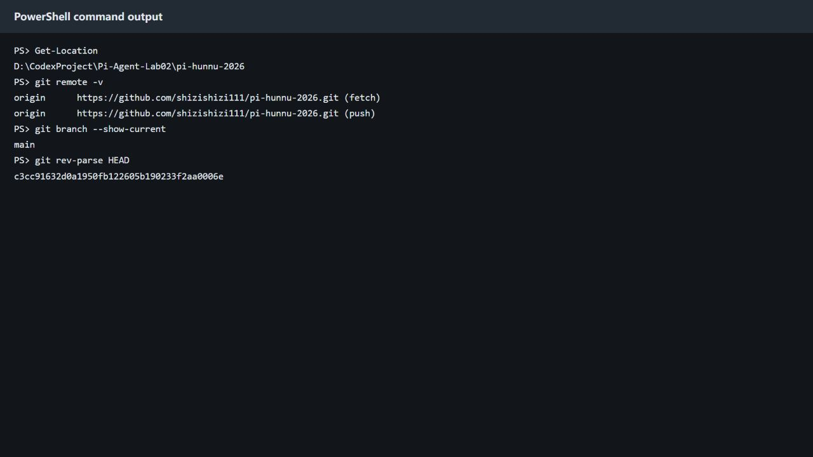
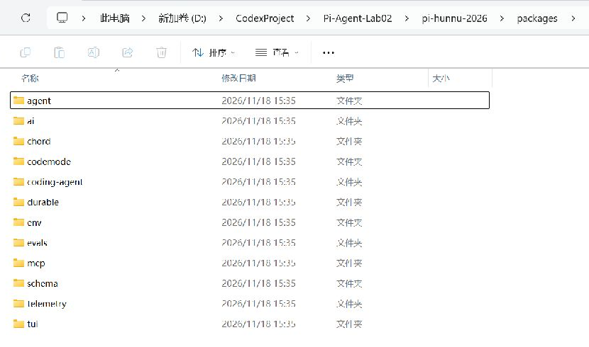
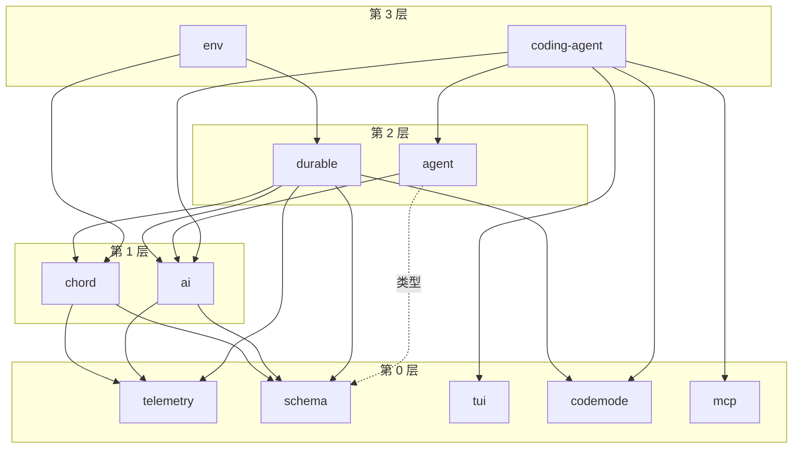

# 实践课 2：小组建仓和 Pi Agent 源码阅读

姓名拼音 `yuanshiwen` · GitHub `shizi-shizi`

## 1. 下载小组仓库的源码

我们组已经把老师的 `pi-hunnu-2026` fork 到了小组组织 `shizishizi111`，[组里的三位成员](https://github.com/hunnuOpenSourceSoftware2026/assignments/issues/53)都有推送权限。我从小组仓库克隆了 `main` 分支。

```powershell
git clone --branch main https://github.com/shizishizi111/pi-hunnu-2026.git
```

| 检查项 | 结果 |
| --- | --- |
| 小组组织仓库 | [`shizishizi111/pi-hunnu-2026`](https://github.com/shizishizi111/pi-hunnu-2026) |
| Fork 来源 | [`hunnuOpenSourceSoftware2026/pi-hunnu-2026`](https://github.com/hunnuOpenSourceSoftware2026/pi-hunnu-2026) |
| 实际 clone 地址 / `origin` | `https://github.com/shizishizi111/pi-hunnu-2026.git` |
| 本地目录 | `D:\CodexProject\Pi-Agent-Lab02\pi-hunnu-2026` |
| 当前分支 | `main` |
| 完整提交号 | [`c3cc91632d0a1950fb122605b190233f2aa0006e`](https://github.com/shizishizi111/pi-hunnu-2026/tree/c3cc91632d0a1950fb122605b190233f2aa0006e) |

图 1. 小组仓库页面，仓库名下方可以看到是从老师的仓库 fork 过来的。


图 2（S1）. 克隆后，我用 `Get-Location` 和几条 Git 命令检查了当前目录、远端地址、分支和提交号。



图 3. 本地仓库的 `packages` 文件夹。



## 2. 构建顺序与模块分析

我先看了仓库根目录的 `package.json`。它的 `build` 脚本用 `cd` 进入每个模块，再运行该模块的 `npm run build`，顺序如下。

```text
telemetry → schema → chord → tui → codemode → mcp
          → ai → durable → env → agent → coding-agent
```

截图里还有一个 `evals` 文件夹。我在根目录的 `build` 脚本里没有找到它，所以表里只列脚本实际调用的 11 个模块。

大部分模块的构建命令都是 `tsc -p tsconfig.build.json`。每个模块有自己的构建配置，共用根目录的 `tsconfig.base.json`。表里的“TS 编译”指把 `src` 里的 TypeScript 编译到 `dist`，生成 `.js`、`.d.ts` 和对应的 `.map` 文件。这次我读了脚本和配置来判断会生成什么，没有跑完整构建。

| 子文件夹 | 代码功能 | `build` 执行与产物 | 直接内部依赖 | 依据文件 |
| --- | --- | --- | --- | --- |
| `telemetry` | 给其他模块提供统一的接口，用来记录一次操作的耗时、计数等信息。源码里有把记录保存在内存里的实现。 | TS 编译，生成指标和追踪相关的代码。 | 无 | `packages/telemetry/package.json`、`src/index.ts`、`src/metrics.ts`、`src/memory.ts` |
| `schema` | 用 JSON Schema 描述数据长什么样，再检查传进来的值是否符合要求。出错时可以指出是哪个字段。 | TS 编译，生成 Schema 构造器和校验器。 | 无 | `packages/schema/package.json`、`src/builders.ts`、`src/compiler.ts`、`src/validator.ts` |
| `chord` | 管理分布在不同进程里的应用对象。其他进程可以通过引用访问对象状态、调用方法，宿主还负责加载和更新插件。 | TS 编译，生成对象宿主、状态管理等代码。 | `schema`、`telemetry` | `packages/chord/package.json`、`src/host/host.ts`、`src/data/validator.ts`、`src/telemetry.ts` |
| `tui` | 负责终端里的显示和输入。内容变化时可以只重画变化的行。 | TS 编译，生成终端界面库。各平台的原生插件有单独的 `build:native:*` 脚本。 | 无 | `packages/tui/package.json`、`src/tui.ts`、`src/tui-main-screen.ts`、`src/tui-alt-screen.ts` |
| `codemode` | 在 QuickJS 的 WebAssembly 环境中运行模型写的 JavaScript，脚本可以调用宿主提供的工具。 | TS 编译，生成脚本运行和工具调用相关的代码。QuickJS WASM 来自 `quickjs-wasi`。 | 无 | `packages/codemode/package.json`、`src/runtime/host.ts`、`src/wasm.ts` |
| `mcp` | 是连接 MCP 服务的客户端。同一套客户端逻辑可以用标准输入输出或 HTTP 等方式收发消息。 | TS 编译，生成客户端、传输和 OAuth 相关代码。 | 无 | `packages/mcp/package.json`、`src/client.ts`、`src/transports/stdio.ts`、`src/transports/streamable-http.ts` |
| `ai` | 给不同厂商的模型提供统一的调用接口，负责接收流式回复、管理模型列表以及检查工具参数。 | 先通过 `generate-models` 生成模型目录、JSON 数据和 `src/models.generated.ts`。再由 `build:offline` 检查数据、编译 TS，并把 JSON 复制到 `dist/providers/data/`。 | `schema`、`telemetry` | `packages/ai/package.json`、`catalog/generate.ts`、`src/models.ts`、`src/utils/validation.ts`、`src/telemetry.ts` |
| `durable` | 把会话和工具调用等进度保存下来，进程中途退出后可以根据保存的状态继续。 | TS 编译，生成持久会话、执行环境接口等代码。编译会用到 `chord` 和 `ai` 生成的类型声明。 | `chord`、`ai`、`codemode`、`schema`、`telemetry` | `packages/durable/README.md`、`package.json`、`tsconfig.build.json`、`src/types.ts`、`src/codemode/codemode.ts`、`src/tools/read.ts` |
| `env` | 让 `durable` 的工具能在远程机器上读写文件、启动进程或监视文件变化。 | TS 编译，生成远程连接和执行环境的代码。`daemon/` 下的 Rust 程序单独构建。 | `chord`、`durable` | `packages/env/package.json`、`README.md`、`tsconfig.build.json`、`src/remote-env.ts`、`src/connection.ts` |
| `agent` | 负责一轮对话里反复运行的逻辑，比如问模型、处理工具调用、把工具结果交回模型。 | TS 编译，生成 `Agent` 类、循环和事件类型。编译时会读取 `ai` 生成的声明文件。 | `ai`、`schema`（`Static` 类型） | `packages/agent/package.json`、`tsconfig.build.json`、`src/agent.ts`、`src/agent-loop.ts`、`src/types.ts` |
| `coding-agent` | 是 Pi 的命令行程序和 SDK 所在的包。它创建会话，把模型、工具和终端界面接起来。 | `build:unbundled` 先编译 TS，设置 CLI、RPC 入口并复制主题、图片、HTML 模板等文件。接着用 esbuild 把入口和所需代码打包到 `dist/bundle/`。 | `agent`、`ai`、`tui`、`codemode`、`mcp` | `packages/coding-agent/package.json`、`src/core/sdk.ts`、`src/main.ts`、`src/extensions/codemode/tool.ts`、`src/extensions/mcp/index.ts`、根目录的 `scripts/build-coding-agent-bundle.mjs` |

## 3. 模块层级与依赖关系

图里的箭头从使用方指向被依赖方。比如 `ai → schema`，因为 `ai` 要用 `schema` 的校验器。我按各包 `package.json` 里的 `dependencies` 找出了仓库内的直接依赖，再对照源码里的 `import`。其中 `agent` 从 `schema` 导入 `Static` 类型，我用虚线标了出来。`package.json` 里写的 `@earendil-works/pi-agent-core` 就是图里的 `agent`。

我把不直接依赖其他内部包的模块放在第 0 层，其余模块放在它所依赖的最高一层之上。比如 `ai` 依赖第 0 层的 `schema` 和 `telemetry`，所以放第 1 层。`agent` 又依赖 `ai`，所以放第 2 层。



[可编辑 Mermaid 图源](dependencies.mmd)

## 4. 分析题

### 4.1 根目录与子模块中的 `npm run build` 分别读取什么配置、执行什么工作？

在根目录运行时，npm 读的是根 `package.json`，里面的 `build` 主要负责按顺序进入各包再执行。进入某个子模块后，npm 就读这个模块的 `package.json`，具体怎么构建要看它自己的 `build` 脚本。

以 `schema` 为例，它的脚本把本包的 `tsconfig.build.json` 交给 `tsc`，这个配置指定源码范围和输出目录，同时继承根目录 `tsconfig.base.json` 的公共设置。根目录还有一个 `tsconfig.json`，其中的 `noEmit: true` 表示只做检查时不生成文件。`ai` 还要先生成模型数据，`coding-agent` 编译后还要复制资源和打包。

### 4.2 构建顺序和模块依赖有什么关系？相邻构建的模块是否一定互相依赖？

有依赖的包要先准备好被依赖包的产物。比如 `env` 构建时会从 `../durable/dist/env/index.d.ts` 读取类型声明，先构建 `durable` 才能生成这个文件。根脚本已经写好了执行顺序，中间有一步出错，后续命令就不会继续。

相邻的两个包不一定有关。`telemetry` 后面紧跟着 `schema`，但它们各自的 `package.json` 都没有声明对方。`coding-agent` 和 `tui` 虽然隔了好几步，前者却直接导入了后者的代码。

### 4.3 选择一条涉及至少三个模块的依赖路径，说明它们如何分工

我重点看的是 `coding-agent → agent → ai → schema` 这条路径。读这几个包时，我想弄清楚一个问题：模型发出工具调用后，参数到底是在哪里检查的？

1. `coding-agent` 在 `createAgentSession()` 中创建 `Agent`，设置它要用的模型，以及怎么发起流式请求。 [`sdk.ts`](https://github.com/shizishizi111/pi-hunnu-2026/blob/c3cc91632d0a1950fb122605b190233f2aa0006e/packages/coding-agent/src/core/sdk.ts#L403-L423)
2. `agent` 收到模型的工具调用后，会先调用 `ai` 里的 `validateToolArguments()`。检查通过后，才把参数交给工具执行。 [`agent-loop.ts`](https://github.com/shizishizi111/pi-hunnu-2026/blob/c3cc91632d0a1950fb122605b190233f2aa0006e/packages/agent/src/agent-loop.ts#L730-L746)
3. `ai` 取出工具对参数的要求，交给 `schema` 的 `compile()`，然后用得到的校验器检查模型给出的值。检查不通过时，它会把出错的字段加到报错里。 [`validation.ts`](https://github.com/shizishizi111/pi-hunnu-2026/blob/c3cc91632d0a1950fb122605b190233f2aa0006e/packages/ai/src/utils/validation.ts)
4. `schema` 实现具体的校验规则。比如工具需要数字，而模型给了字符串 `"42"`，开启类型转换时，校验器可以把它转成数字 `42`。 [`validator.ts`](https://github.com/shizishizi111/pi-hunnu-2026/blob/c3cc91632d0a1950fb122605b190233f2aa0006e/packages/schema/src/validator.ts)
