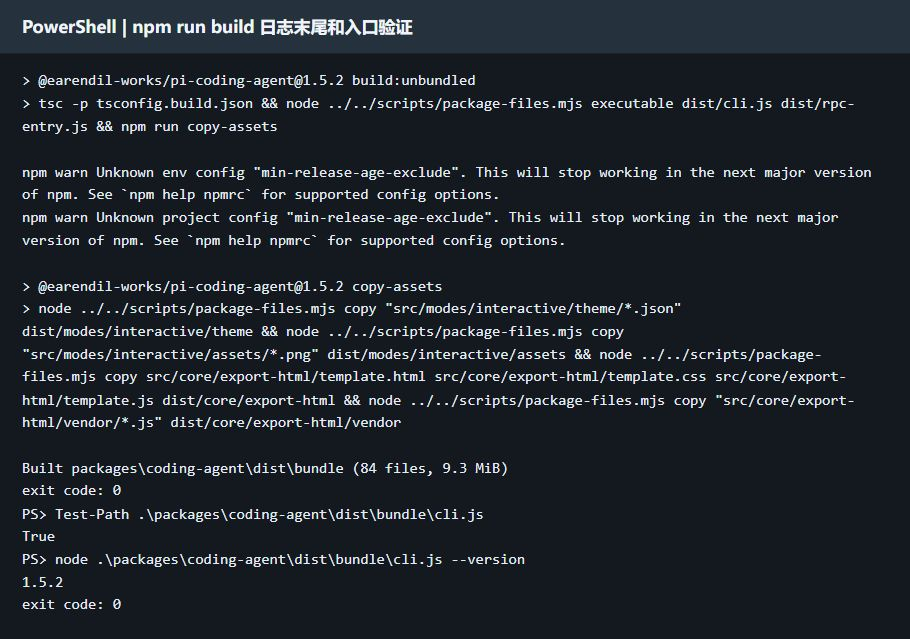
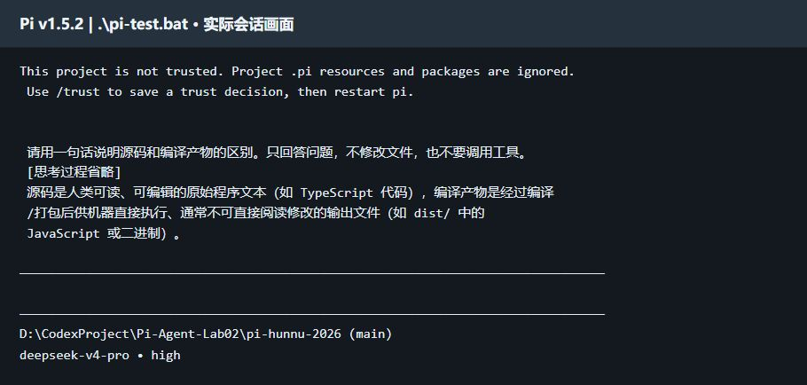

# 实践课 3：Pi Agent 源码安装与编译

姓名拼音：`yuanshiwen` · GitHub：`shizi-shizi`

## 1. 检查工具版本

我先在 PowerShell 里查了版本：Node.js 是 `v24.18.0`，npm 是 `11.16.0`，Git 是 `2.55.0.windows.2`。这台电脑已经装了 Node.js 24，不用再装一遍。

## 2. 确认本地源码

我继续用实验二克隆好的仓库。进入 `D:\CodexProject\Pi-Agent-Lab02\pi-hunnu-2026` 后，我用 `git remote -v` 确认 `origin` 是小组仓库，不是老师的仓库；分支是 `main`，完整提交号是 `c3cc91632d0a1950fb122605b190233f2aa0006e`。`git status --short` 没有输出，说明这时没有未提交的改动。

实际 clone 地址：<https://github.com/shizishizi111/pi-hunnu-2026.git>

## 3. 看安装和构建配置

根目录 `README.md` 的 Development 一节给出了安装、联网构建和离线重建命令。根 `package.json` 的 `engines.node` 写的是 `>=22.19.0`，所以 Node.js 24 是实验推荐版本，并不是配置里的最低版本。它的 `workspaces` 把 `packages/`、`apps/` 等目录里的包放在一起管理，根目录下的 `package-lock.json` 记录了解析后的依赖和版本。TypeScript 和 esbuild 等构建工具列在根 `devDependencies` 里。

`npm run build` 读的是当前包 `package.json` 中的 `scripts.build`。在根目录执行时，脚本按顺序进入各个子包，让它们自己执行 `build`。这些命令用 `&&` 连起来，前一步出错，后面的包就不会继续构建。最后进入 `packages/coding-agent`，它自己的 `bin.pi` 指向 `dist/bundle/cli.js`。

## 4. 安装依赖

我在仓库根目录运行 `npm install --ignore-scripts`。这个命令按 `package.json` 和锁文件安装依赖，把工具和库装进本地 `node_modules`，也会关联仓库里的工作区包。`--ignore-scripts` 让安装阶段跳过 `prepare`、`postinstall` 等脚本，之后手动运行 `npm run build` 仍然有效。这次没有用 `-g`，不会把全局的 `pi` 换成实验版本。

本次安装新增了 333 个包，审计了 356 个包，退出码是 `0`，根目录下也有了 `node_modules`。[安装日志和警告处理过程见第 7.1 节（S4）](#71-安装出现警告怎么确认还能继续)

## 5. 构建并运行产物

我在仓库根目录运行了 `npm run build`。日志先列出各子包的编译过程，到 `ai` 包时联网生成模型目录。这一步下载的是模型名称、能力等资料，不是模型权重。最后 `coding-agent` 编译 TypeScript、复制程序资源，再打出 `dist/bundle`，日志显示 84 个文件、共 9.3 MiB，构建退出码是 `0`。

接着我用 `Test-Path .\packages\coding-agent\dist\bundle\cli.js` 检查入口，返回 `True`；运行 `node .\packages\coding-agent\dist\bundle\cli.js --version` 得到 `1.5.2`，退出码也是 `0`。这样能确认跑的是这次构建出的文件，不是 PATH 上的全局 `pi`。

构建末尾的输出和入口验证也放在 [第 7.1 节（S5）](#71-安装出现警告怎么确认还能继续)。

以后如果模型目录数据还有效，可以用 `npm run build:offline` 重新编译，省去联网刷新目录这一步。本次首次构建用的是联网命令。

## 6. 启动源码版并提问

我先运行 `.\pi-test.bat --version`，同样返回 `1.5.2`。随后直接运行 `.\pi-test.bat` 进入交互界面，问了“请用一句话说明源码和编译产物的区别。只回答问题，不修改文件，也不要调用工具。”模型实际回复了，把 TypeScript 代码和 `dist` 中生成的 JavaScript 作为例子。验证到回复以后，我退出了 Pi。

[启动提示和实际问答截图见第 7.2 节（S6a、S6b）](#72-启动源码版时遇到项目的信任提示)

我看了 `.bat` 和 `.ps1`：前者调用后者，后者让 Node.js 加载源码解析器，再跑 `packages/coding-agent/src/cli.ts`。源码入口适合改好 `src` 后试运行；`dist/bundle/cli.js` 适合检查编译和打包后的版本能不能运行。两个入口这次都显示 `1.5.2`，所以要看运行路径，不能只看版本号。

## 7. 遇到的困难和解决过程

### 7.1 安装出现警告，怎么确认还能继续？

执行 `npm install --ignore-scripts` 时，npm 提示不识别 `.npmrc` 里的 `min-release-age-exclude`，还提示 `prebuild-install` 和 `node-domexception` 已弃用。安装末尾又出现 `7 high severity vulnerabilities`。这些消息都在一屏里，我先要确认依赖到底装好了没有。

我先看了安装命令的退出码，是 `0`。日志里有 `added 333 packages`，检查 `node_modules` 也返回了 `True`。这三项可以确认安装已完成。7 项高危问题是 npm 对这次依赖树的审计结果，我把它留在记录里，继续用课程的锁文件进行构建。

接着我跑完了根目录的 `npm run build`。构建期间又出现了同一条配置警告，所以我看到最后的 `Built ... dist\bundle` 和退出码 `0` 才确认构建完成。我又检查了 `dist\bundle\cli.js`，返回 `True`，用 Node.js 运行该文件得到 `1.5.2`。到这里，我才确认这些安装警告没有卡住本次构建和本地 CLI 验证。审计报告的依赖问题本次没有修复。

### 7.2 启动源码版时遇到项目的信任提示

`.\pi-test.bat --version` 能打印版本，但直接运行 `.\pi-test.bat` 后，Pi 先停在 `Trust project folder?`，需要选一项才能进入会话。提示里写着，信任这个目录会允许 Pi 使用项目的 `.pi` 设置、安装项目包和执行项目扩展。

这次只需要问一句关于源码的问题，所以我选择了 `Do not trust (this session only)`。进到会话后，终端提示项目的 `.pi` 资源和项目包已跳过。我发出了问题，模型返回了一句解释，说明在这次会话里跳过项目资源也能完成问答。

图 S6b 从实际终端输出截取，保留了问题和最终回复，省略了思考过程和用量统计。
