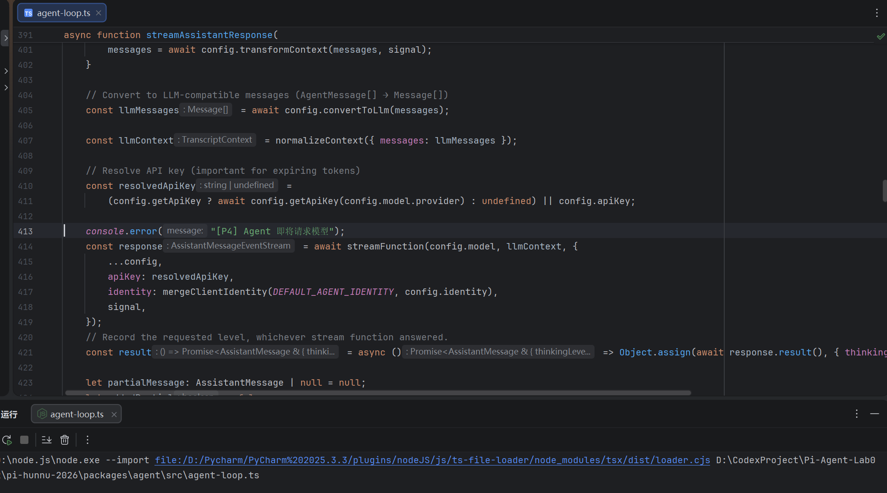
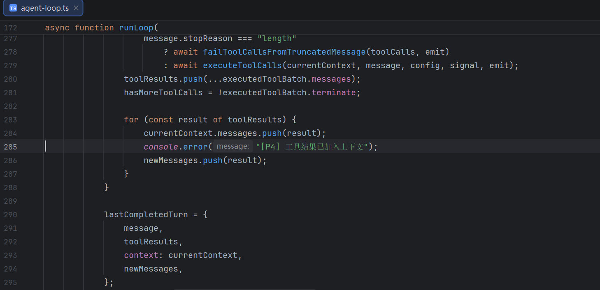
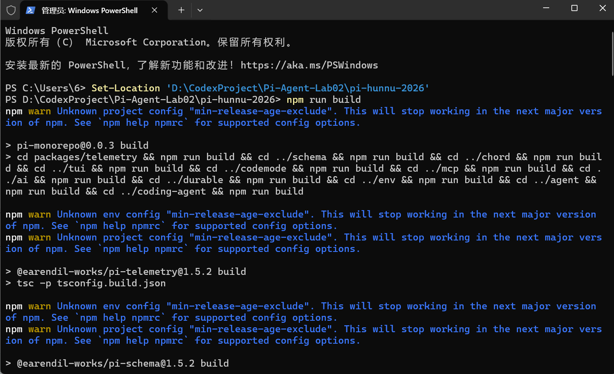
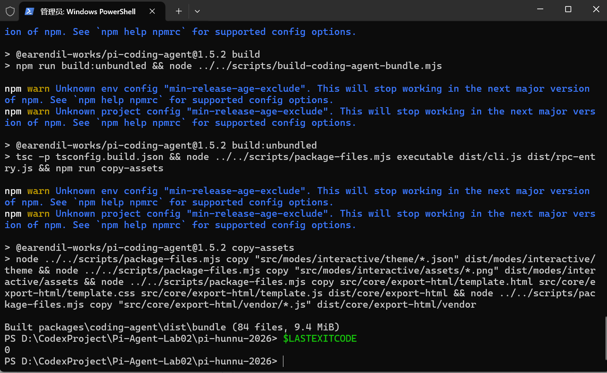
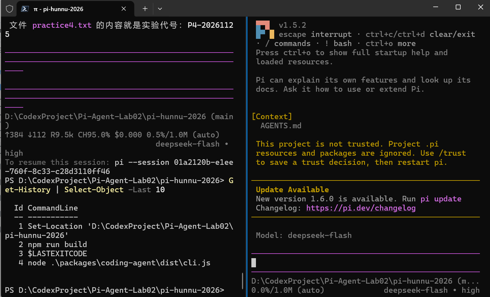
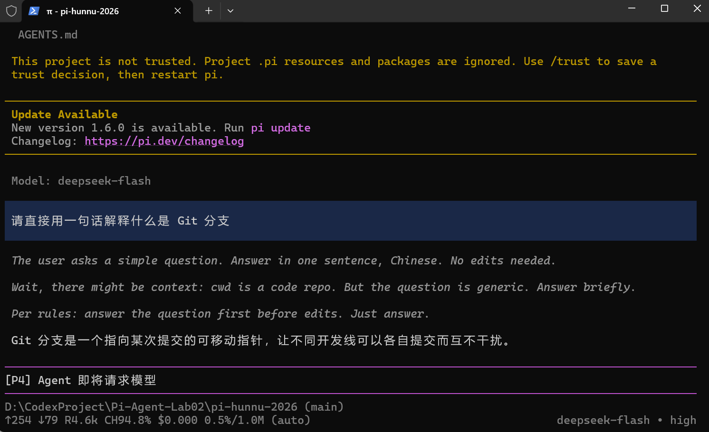
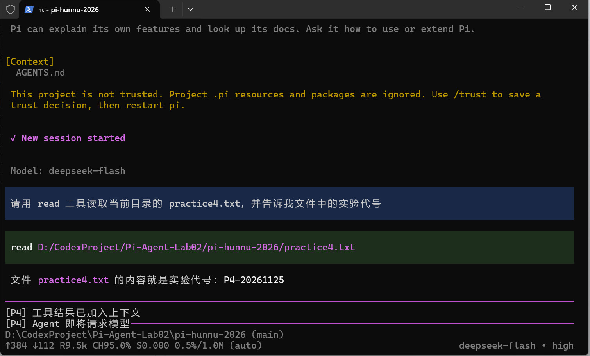
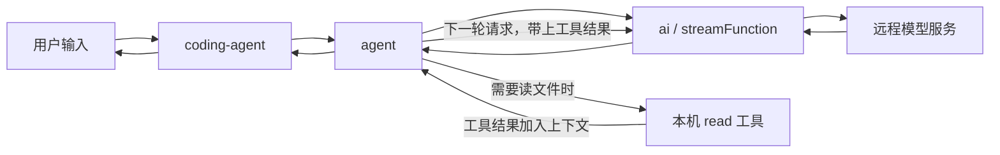

# 实践课 4：Pi Agent 的模型调用与运行流程

姓名拼音：`yuanshiwen` · GitHub：`shizi-shizi`

## 1. 修改 Agent 循环

我在小组仓库 `pi-hunnu-2026` 的 `packages/agent/src/agent-loop.ts` 加了两条日志。第一条放在 `currentContext.messages.push(result)` 后面，所以每有一条工具结果加入当前上下文，就会记录一次。第二条放在 `streamFunction(...)` 前面，表示 Agent 即将调用模型。

```diff
for (const result of toolResults) {
    currentContext.messages.push(result);
    console.error("[P4] 工具结果已加入上下文");
    newMessages.push(result);
}

console.error("[P4] Agent 即将请求模型");
const response = await streamFunction(config.model, llmContext, {
```

源码已经按实验要求修改，并已提交到小组仓库 `main` 分支，提交号为 `b13deeda1`；

S1：编辑器中的模型请求日志位置。



S2：工具结果加入上下文后的位置。



## 2. 重新编译

我在源码仓库根目录运行了 `npm run build`。第一次构建在 `packages/ai` 更新模型目录时，因为连接 `models.dev` 失败而退出，退出码为 `1`。之后重试和本次重新核验时，同一条构建命令都成功完成，最终输出 `Built packages\coding-agent\dist\bundle (84 files, 9.4 MiB)`，本次退出码为 `0`。构建日志中有 npm 对 `min-release-age-exclude` 的配置警告，但没有影响构建完成。

我随后运行 `node .\packages\coding-agent\dist\cli.js --version`，得到 `1.5.2`，退出码为 `0`。

S3：重新编译及退出码。





S4：启动命令与 Pi 界面。



## 3. 实验模型和代号文件

为了避免使用费用较高的 v4pro，我先从 Pi 本地模型目录中确认了 Flash 选项，列表显示 provider 为 `deepseek`、模型 ID 为 `deepseek-flash`。`pi auth check --provider deepseek --no-refresh` 返回 `ready`。下面两次独立会话都明确使用 `deepseek/deepseek-flash`。

我在项目根目录的 `practice4.txt` 写入了实验代号：

```text
P4-20261125
```

## 4. 会话 A：直接问答

输入给 Pi 的指令：

> 请直接用一句话解释什么是 Git 分支。

这次通过本地编译产物以交互模式运行，命令指定了 `deepseek/deepseek-flash`，并用 `--no-approve` 忽略本次项目资源。Pi 启动后显示了输入指令和最终回复，交互进程以退出码 `0` 结束。实际日志只有一条：

```text
[P4] Agent 即将请求模型
```

Pi 的实际回复是：

> Git 分支是一个指向某次提交的可移动指针，让不同开发线可以各自提交而互不干扰。

本次没有工具结果日志，说明这条指令由模型直接回答，没有调用文件读取工具。按“即将请求模型”日志计，共进入 1 轮模型调用。

S5：会话 A 的实际输入、回复和模型请求日志。



## 5. 会话 B：读取文件

输入给 Pi 的指令：

> 请用 read 工具读取当前目录的 practice4.txt，并告诉我文件中的实验代号。

这次同样是单独的交互会话，模型仍为 `deepseek/deepseek-flash`，并通过 `--tools read` 限定只启用 `read` 工具。Pi 显示了 `read practice4.txt:1-50` 的工具记录，并返回了文件中的实验代号，交互进程以退出码 `0` 结束。日志顺序如下：

```text
[P4] Agent 即将请求模型
[P4] 工具结果已加入上下文
[P4] Agent 即将请求模型
```

Pi 的实际回复为：

> 文件 `practice4.txt` 只有一行内容 `P4-20261125`，实验代号为 `P4-20261125`。

这次先有一次模型请求，随后出现工具结果已加入上下文的日志，再发起第二次模型请求，共 2 轮模型调用。实际读取文件的是 Pi 的 `read` 工具，不是远程模型服务直接读取我的电脑。工具读取到文件后，Agent 将工具结果加入 `currentContext.messages`；下一轮请求因此带上了此前对话和文件读取工具返回的内容，模型才能据此给出代号。

S6：会话 B 的实际输入、read 工具记录、实验代号和两类日志。



## 6. 运行流程



结合这次 B 的记录，模型先提出读取文件所需的工具调用；`read` 工具在本机读取文件并把结果交还 Agent；Agent 把结果追加到上下文后再次请求模型；远程模型服务根据新增的工具结果生成最终回复。
