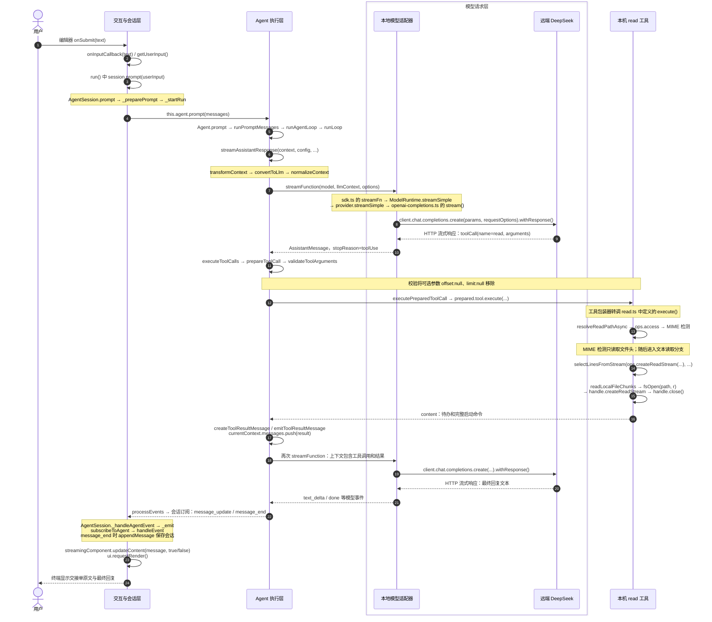
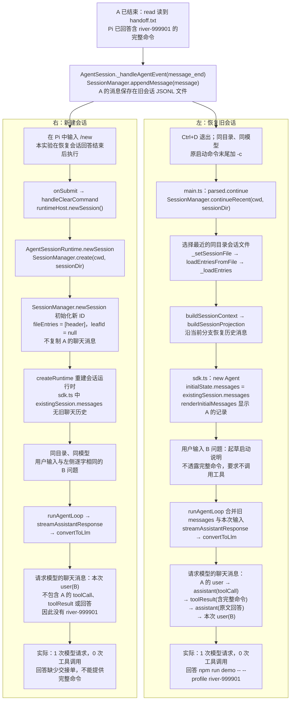

# 实践课 5：Pi Agent 工具调用与会话恢复

姓名拼音：`yuanshiwen` · GitHub：`shizi-shizi` · 实验日期：2026 年 11 月 26 日

这次实验主要看两个问题：Pi 怎样调用 `read` 读取本地文件，以及退出后恢复会话和重新开始会话有什么区别。我先在终端中操作，再结合日志和源码梳理调用过程。

## 1. 实验环境与操作

| 项目 | 配置 |
| --- | --- |
| 小组源码仓库 | [shizishizi111/pi-hunnu-2026](https://github.com/shizishizi111/pi-hunnu-2026) |
| 源码版本 | [`b13deeda133d97a8c5fd70b42e5c72960a1e174b`](https://github.com/shizishizi111/pi-hunnu-2026/tree/b13deeda133d97a8c5fd70b42e5c72960a1e174b) |
| 工作目录 | `D:\CodexProject\Pi-Agent-Lab02\pi-hunnu-2026` |
| 启动程序 | 本地已构建的 `packages/coding-agent/dist/cli.js`，版本 `1.5.2` |
| 模型 | 三个阶段均为 `deepseek/deepseek-flash`，thinking 为 `high` |
| 会话目录 | `D:\CodexProject\Pi-Agent-Lab02\practice5-private-sessions` |

实验沿用实践 4 构建的程序和添加的 `[P4]` 日志，没有重新构建或修改业务源码。我单独设置了 `--session-dir`，方便恢复时找到这次的会话。退出再启动时，工作目录、模型、工具配置和会话目录都保持一致。

我在源码仓库根目录创建了 `handoff.txt`，把随机生成的标识 `river-999901` 写进启动命令：

```text
待办：补充 README 的启动说明
启动命令：npm run demo -- --profile river-999901
```

这条命令用来检查 Pi 能否从文件中获得信息，并在恢复会话后保留它。这次只读取和引用命令，没有执行它。

接着在 PowerShell 中启动 Pi，等交互界面出现后再输入问题：

```powershell
node .\packages\coding-agent\dist\cli.js --model deepseek/deepseek-flash --tools read --no-approve --no-extensions --no-skills --no-prompt-templates --no-mcp --offline --tui-mode regular --session-dir 'D:\CodexProject\Pi-Agent-Lab02\practice5-private-sessions'
```

启动时用 `--tools read` 保留读取工具，后面的两次提问也没有关闭它。我在问题中要求 Pi 不调用工具，再从日志确认它有没有遵守。`--offline` 只关闭启动时的联网操作，模型请求仍然联网；`--no-approve` 用来忽略项目内的扩展资源。

## 2. A 阶段：读取交接单

在新会话中，我输入下面的问题，没有把启动命令和随机标识告诉 Pi：

> 请用 read 工具读取当前目录的 handoff.txt，原样告诉我待办和启动命令。

Pi 先回复“我会读取该文件。”，随后调用了 `read`。会话文件中记录的原始参数如下：

```json
{
  "name": "read",
  "arguments": {
    "path": "D:/CodexProject/Pi-Agent-Lab02/pi-hunnu-2026/handoff.txt",
    "offset": null,
    "limit": null
  }
}
```

对应的 `toolResult` 返回了交接单的两行原文，`isError` 为 `false`。Pi 最终回复中也包含：

```text
待办：补充 README 的启动说明
启动命令：npm run demo -- --profile river-999901
```

终端日志依次为：

```text
[P4] Agent 即将请求模型
[P4] 工具结果已加入上下文
[P4] Agent 即将请求模型
```

从日志可以看出，**1 次用户输入触发了 1 次 read 执行和 2 次模型请求**。第一次请求后，模型给出工具调用；本机执行 `read`，把结果加入上下文后，再发起第二次请求，得到最后的回答。随后我按 `Ctrl+D` 退出，进程退出码为 `0`。

### 图 1：单轮工具调用的代码级时序图

下面按用户输入、会话处理、Agent 执行、模型请求和工具执行梳理调用顺序。模型请求部分分为本地适配器和远端模型，便于看出请求在哪里发出、文件在哪里读取。同一层内涉及多个文件的调用写在自调用和注释中。



#### read 怎样读取文件内容

读到 `read.ts` 时，我注意到里面既有流式读取，也有缓冲区读取。因此，还需要结合这次的参数判断走了哪个分支。

工具记录里的 `offset`、`limit` 都是 `null`，但参数在执行前还会经过 `validateToolArguments()`。`pi-schema` 会移除这两个可选字段。我用本地构建产物单独校验了这组参数，输出只剩 `path`，此时 `offset`、`limit` 均为 `undefined`。这样，`isStreamableRange()` 返回真，配合默认的 `createReadStream: readLocalFileChunks`，文本内容便通过 `selectLinesFromStream()` 读取。底层先调用 `fs/promises.open()`，再用 `FileHandle.createReadStream()` 读取，最后关闭文件句柄。

在读取正文前，`detectSupportedImageMimeTypeFromFile()` 会先读取少量文件头，判断是不是支持的图片类型。这一步用了缓冲区，但正文仍然走流式读取。只有没有提供流式读取操作，或参数范围不适合流式读取时，才会进入 `selectLinesFromBuffer(await ops.readFile(...))` 分支。

## 3. B 阶段：恢复会话与新建会话对照

### 3.1 退出后加 -c 恢复

我回到同一个 PowerShell 工作目录，再次运行上面的启动命令，**在末尾加上 `-c`**。Pi 启动后，界面中出现了 A 阶段的提问、`read handoff.txt` 记录，以及包含 `river-999901` 的回答。

恢复前后的会话 ID 都是 `01a21695-dfee-77a0-835c-f9cd61c6ad53`。随后输入：

> 接着上次的待办，给 README 起草一条启动说明，写出交接单里的完整启动命令。只用这次会话已有的信息。不要调用工具。如果缺少命令，请直接说明。

Pi 的回答以“README 里可以加这一节（草稿）”开头，给出 `## 启动`，并写出了完整命令：

```bash
npm run demo -- --profile river-999901
```

Pi 还说明这就是交接单中的完整命令，但无法确定前置安装步骤、Node 版本和 profile 的含义。它给出的草稿有代码围栏嵌套问题，所以这里单独列出命令，完整回复保存在 [实验记录](practice5-evidence.json) 中。

这一轮有 **1 次模型请求、0 次工具调用**。Pi 没有重新读取文件，却能写出带随机标识的完整命令，说明恢复的历史为这次回答提供了信息。后面的源码分析也能解释这个结果。

### 3.2 在同一个 Pi 进程中输入 /new

等回答结束后，我输入 `/new`，终端显示 `New session started`。接着输入与 3.1 **完全相同**的问题，模型仍为 `deepseek/deepseek-flash`。

这时会话 ID 变为 `01a21698-5000-7137-b542-71df942dba2e`。Pi 的完整回复如下：

> 这次会话里没有交接单，也没有之前的待办内容。我看不到那条启动命令的具体内容，包括工具名、参数、路径或环境变量。
>
> 因此无法起草完整命令。需要你提供以下任一信息：
>
> - 交接单里那条启动命令的原文
> - 或交接单本身
>
> 拿到原文后我再写进 README，并说明每一步的作用。

这一轮也是 **1 次模型请求、0 次工具调用**，回答中没有出现 `river-999901`。最后按 `Ctrl+D` 退出，进程退出码为 `0`。三个阶段的结果放在一起比较如下：

| 阶段 | 模型请求数 | 工具执行数 | 回答是否包含完整命令 |
| --- | ---: | ---: | --- |
| A：新会话读取文件 | 2 | 1 | 是，读取后原样返回 |
| B：退出后用 -c 恢复 | 1 | 0 | 是，包含 `river-999901` |
| B：/new 后输入同一问题 | 1 | 0 | 否，明确说明缺少信息 |

表中的次数来自 `[P4]` 日志，并与会话里的工具调用和 `toolResult` 记录作了对照。后两次的问题完全相同，模型和工具配置也相同，但因为会话历史不同，得到的回答明显不同。

### 图 2：恢复旧会话与新建会话的对照图



图中只列出这次对照涉及的聊天消息，系统提示、模型和工具配置仍然存在。恢复时，`buildSessionProjection()` 会根据当前分支、压缩记录和上下文编辑整理出有效历史。这次没有压缩、分支切换或手动编辑上下文，因此可以直接沿着保存的消息分析恢复过程。

## 4. 源码位置与修改思路

下面整理了阅读时用到的主要源码位置，以及修改相关功能时可以从哪里入手。链接和行号都对应实验使用的提交。

| 功能 | 源码位置与关键调用 | 可以修改的内容 |
| --- | --- | --- |
| 输入入口和交互主循环 | [interactive-mode.ts](https://github.com/shizishizi111/pi-hunnu-2026/blob/b13deeda133d97a8c5fd70b42e5c72960a1e174b/packages/coding-agent/src/modes/interactive/interactive-mode.ts#L3324)：`defaultEditor.onSubmit`；3516–3520 行把输入交给回调或队列；1293–1296 行 `getUserInput()` 后调用 `session.prompt()` | 改输入命令识别或提交行为 |
| 会话到 Agent | [agent-session.ts](https://github.com/shizishizi111/pi-hunnu-2026/blob/b13deeda133d97a8c5fd70b42e5c72960a1e174b/packages/coding-agent/src/core/agent-session.ts#L2175)：`prompt()` → `_preparePrompt()` → `_startRun()`；1982 行 `this.agent.prompt(messages)` | 改输入预处理、会话级策略 |
| Agent 循环 | [agent.ts](https://github.com/shizishizi111/pi-hunnu-2026/blob/b13deeda133d97a8c5fd70b42e5c72960a1e174b/packages/agent/src/agent.ts#L382)：`prompt()`；441–453 行 `runPromptMessages()` → `runAgentLoop()` | 改一次运行如何开始；会话恢复不在这里直接读取文件 |
| 工具与下一次请求 | [agent-loop.ts](https://github.com/shizishizi111/pi-hunnu-2026/blob/b13deeda133d97a8c5fd70b42e5c72960a1e174b/packages/agent/src/agent-loop.ts#L251)：`streamAssistantResponse()`、`executeToolCalls()`、284 行 `currentContext.messages.push(result)`；391–419 行构建并发送模型上下文 | 改工具调用循环和观测日志 |
| 模型适配及网络边界 | [sdk.ts 412–422 行](https://github.com/shizishizi111/pi-hunnu-2026/blob/b13deeda133d97a8c5fd70b42e5c72960a1e174b/packages/coding-agent/src/core/sdk.ts#L412) → [ModelRuntime.streamSimple](https://github.com/shizishizi111/pi-hunnu-2026/blob/b13deeda133d97a8c5fd70b42e5c72960a1e174b/packages/coding-agent/src/core/model-runtime.ts#L744) → [openai-completions.ts 384–385 行](https://github.com/shizishizi111/pi-hunnu-2026/blob/b13deeda133d97a8c5fd70b42e5c72960a1e174b/packages/ai/src/api/openai-completions.ts#L384)：`client.chat.completions.create(...).withResponse()` | 改模型请求参数和协议适配；本次 API 是 `openai-completions`，远端服务仍是 DeepSeek |
| 实际文件读取 | [read.ts](https://github.com/shizishizi111/pi-hunnu-2026/blob/b13deeda133d97a8c5fd70b42e5c72960a1e174b/packages/coding-agent/src/core/tools/read.ts#L229)：工具 `execute()`；301–308 行选流式或缓冲区；81–91 行打开文件、流式读取、关闭 | 改路径、行范围、截断或文件读取行为 |
| 工具参数校验 | [validation.ts 54–65 行](https://github.com/shizishizi111/pi-hunnu-2026/blob/b13deeda133d97a8c5fd70b42e5c72960a1e174b/packages/ai/src/utils/validation.ts#L54) 与 [schema/coerce.ts](https://github.com/shizishizi111/pi-hunnu-2026/blob/b13deeda133d97a8c5fd70b42e5c72960a1e174b/packages/schema/src/coerce.ts#L112) | 排查模型参数与工具收到的参数为什么不同 |
| 回复显示 | [interactive-mode.ts 3525 行](https://github.com/shizishizi111/pi-hunnu-2026/blob/b13deeda133d97a8c5fd70b42e5c72960a1e174b/packages/coding-agent/src/modes/interactive/interactive-mode.ts#L3525)：`session.subscribe()` → `handleEvent()`；3649 行 `message_update`，3685 行 `message_end`；调用 `updateContent(..., true/false)`、`ui.requestRender()` | 改流式显示、最终文本或工具记录展示 |
| 会话保存和恢复 | [agent-session.ts 1213–1232 行](https://github.com/shizishizi111/pi-hunnu-2026/blob/b13deeda133d97a8c5fd70b42e5c72960a1e174b/packages/coding-agent/src/core/agent-session.ts#L1213) 在 `message_end` 保存；[main.ts 479–480 行](https://github.com/shizishizi111/pi-hunnu-2026/blob/b13deeda133d97a8c5fd70b42e5c72960a1e174b/packages/coding-agent/src/main.ts#L479) 处理 `-c`；[session-manager.ts 1811 行](https://github.com/shizishizi111/pi-hunnu-2026/blob/b13deeda133d97a8c5fd70b42e5c72960a1e174b/packages/coding-agent/src/core/session-manager.ts#L1811) 选择旧文件，544–583 行重建有效历史；[sdk.ts 403–409 行](https://github.com/shizishizi111/pi-hunnu-2026/blob/b13deeda133d97a8c5fd70b42e5c72960a1e174b/packages/coding-agent/src/core/sdk.ts#L403) 注入 Agent 初始状态 | 改恢复哪个会话、恢复哪些历史信息 |
| 新建会话 | [interactive-mode.ts 3429 行](https://github.com/shizishizi111/pi-hunnu-2026/blob/b13deeda133d97a8c5fd70b42e5c72960a1e174b/packages/coding-agent/src/modes/interactive/interactive-mode.ts#L3429) 识别 `/new`，7117 行 `handleClearCommand()`；[agent-session-runtime.ts 226–259 行](https://github.com/shizishizi111/pi-hunnu-2026/blob/b13deeda133d97a8c5fd70b42e5c72960a1e174b/packages/coding-agent/src/core/agent-session-runtime.ts#L226) 创建新 SessionManager 并重建运行时；[session-manager.ts 1065 行](https://github.com/shizishizi111/pi-hunnu-2026/blob/b13deeda133d97a8c5fd70b42e5c72960a1e174b/packages/coding-agent/src/core/session-manager.ts#L1065) 初始化新历史 | 改新会话初始化；本版本不是简单调用 `agent.reset()` |

## 5. 实验总结

通过这次实验，我把一次读文件问答的过程串了起来：模型先提出工具调用，本机的 `read` 工具读取文件，再把结果交给模型生成回答。所以终端里的一轮问答，内部可能有多次模型请求，这次就有两次。

恢复会话后，Pi 能写出完整命令，是因为 `-c` 找到了旧会话文件，并把其中的工具结果和回复加载进模型上下文。输入 `/new` 后，新会话没有这些历史消息。虽然 `handoff.txt` 还在原目录，但问题又要求不调用工具，Pi 就无法获得文件中的命令。

阅读源码时，有两处需要继续往下追。一处是会话恢复：界面显示了旧聊天，还要看到 `buildSessionContext()` 整理历史、`initialState.messages` 接收这些消息，才能解释模型为什么能接着回答。另一处是工具参数：会话里记录的 `null` 在执行前会被校验转换，判断读取分支时要看转换后的参数。

各阶段的输入、工具参数、工具结果和完整回复保存在 [practice5-evidence.json](practice5-evidence.json) 中。
