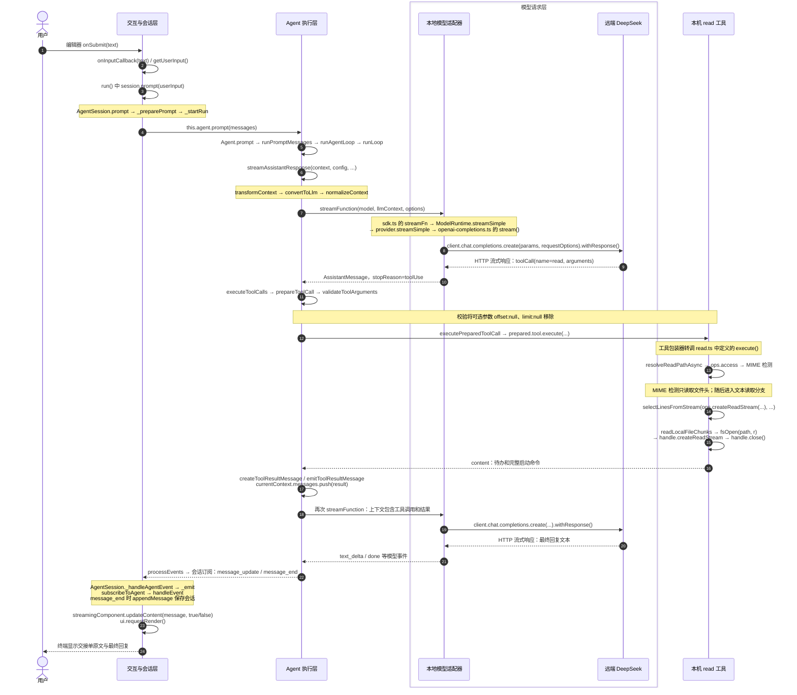
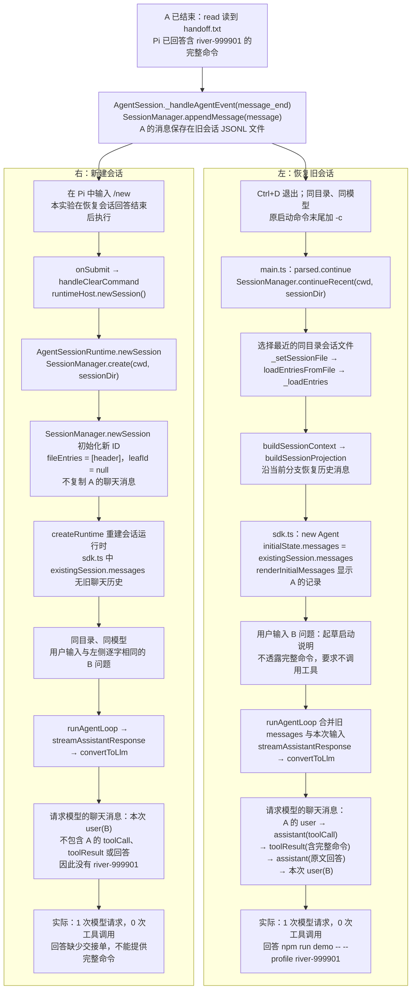

# 实践课 5：Pi Agent 工具调用与会话恢复

姓名拼音：`yuanshiwen` · GitHub：`shizi-shizi` · 实验日期：2026 年 11 月 26 日

本次从实际运行的 Pi 交互回到源码，跟踪一次 `read` 调用，并比较 `-c` 恢复旧会话和 `/new` 新建会话的区别。报告文件名按课程要求保留为 `practive-05.md`。

## 1. 实验环境与操作

| 项目 | 本次实际使用的值 |
| --- | --- |
| 小组源码仓库 | [shizishizi111/pi-hunnu-2026](https://github.com/shizishizi111/pi-hunnu-2026) |
| 源码版本 | [`b13deeda133d97a8c5fd70b42e5c72960a1e174b`](https://github.com/shizishizi111/pi-hunnu-2026/tree/b13deeda133d97a8c5fd70b42e5c72960a1e174b) |
| 工作目录 | `D:\CodexProject\Pi-Agent-Lab02\pi-hunnu-2026` |
| 启动程序 | 本地已构建的 `packages/coding-agent/dist/cli.js`，版本 `1.5.2` |
| 模型 | 三个阶段均为 `deepseek/deepseek-flash`，thinking 为 `high` |
| 会话目录 | `D:\CodexProject\Pi-Agent-Lab02\practice5-private-sessions` |

沿用实践 4 构建的程序和 `[P4]` 观测日志，本次没有重新构建或修改业务源码。为了让 `-c` 只查找本次实验会话，我使用独立的 `--session-dir`；退出前后工作目录、模型、工具配置和会话目录保持一致。

在源码仓库根目录创建 `handoff.txt`，随机生成本次标识 `river-999901`，文件内容是：

```text
待办：补充 README 的启动说明
启动命令：npm run demo -- --profile river-999901
```

这里的启动命令是交接单中的实验数据，用于验证信息是否进入和保留在会话上下文中。本实验只让 Pi 读取、复述和起草说明，没有执行这条 demo 命令。

PowerShell 中使用的启动命令如下，末尾没有加入提示词，等待 Pi 界面启动后再输入：

```powershell
node .\packages\coding-agent\dist\cli.js --model deepseek/deepseek-flash --tools read --no-approve --no-extensions --no-skills --no-prompt-templates --no-mcp --offline --tui-mode regular --session-dir 'D:\CodexProject\Pi-Agent-Lab02\practice5-private-sessions'
```

`--tools read` 保留文件读取能力；两次后续提问中没有关闭这个工具，所以“没有调用工具”是实际观察结果。`--offline` 只关闭启动时的联网操作，模型请求仍正常联网。`--no-approve` 忽略项目内的扩展资源，本次无需加载这些资源。

## 2. A 阶段：实际读取交接单

新会话输入课程规定的原话，提问中不提供启动命令或随机标识：

> 请用 read 工具读取当前目录的 handoff.txt，原样告诉我待办和启动命令。

Pi 先回复“我会读取该文件。”，然后实际发出一次工具调用。会话文件中的原始参数是：

```json
{
  "name": "read",
  "arguments": {
    "path": "D:/CodexProject/Pi-Agent-Lab02/pi-hunnu-2026/handoff.txt",
    "offset": null,
    "limit": null
  }
}
```

对应的 `toolResult` 返回了交接单的两行原文，`isError` 为 `false`。Pi 最终回复中也包含：

```text
待办：补充 README 的启动说明
启动命令：npm run demo -- --profile river-999901
```

终端中实际出现的日志顺序为：

```text
[P4] Agent 即将请求模型
[P4] 工具结果已加入上下文
[P4] Agent 即将请求模型
```

因此，这次是 **1 次用户输入、1 次 read 执行、2 次模型请求**。第一次模型响应提出工具调用，本机执行 `read` 后，把结果加入上下文，再请求模型生成最后的回答。A 阶段完成后按 `Ctrl+D` 正常退出，进程退出码为 `0`。

### 图 1：单轮工具调用的代码级时序图

按用户、交互与会话、Agent 执行、模型请求、read 工具这五组职责绘制；为了明确网络边界，将模型请求组拆成“本地适配器”和“远端模型”两条生命线。同组内的跨文件调用用自调用和注释说明。



#### 文件究竟怎样读到

本版本的 `read.ts` 同时存在流式和缓冲区读取，不能只看到 `fsReadFile` 的导入就判断本次用了整个文件缓冲区。

本次工具记录里的 `offset`、`limit` 虽为 `null`，但 Agent 执行前调用 `validateToolArguments()`，由 `pi-schema` 的可选字段转换规则移除它们。我用本地构建产物对这组原始参数单独运行校验，输出只剩 `path`，验证 `offset`、`limit` 均为 `undefined`。因此 `isStreamableRange()` 为真，配合默认的 `createReadStream: readLocalFileChunks`，实际文本内容走 `selectLinesFromStream()`。底层是 `fs/promises.open()` 后的 `FileHandle.createReadStream()`，最后关闭文件句柄。

`detectSupportedImageMimeTypeFromFile()` 在此前会用缓冲区读取少量文件头来区分图片与文本；这一步不等于把文本内容整体通过 `fsReadFile()` 载入。没有流式操作或参数范围不适合流式读取时，才会进入 `selectLinesFromBuffer(await ops.readFile(...))` 的备用分支。

## 3. B 阶段：恢复会话与新建会话对照

### 3.1 退出后加 -c 恢复

在同一个 PowerShell 工作目录再次运行上面的完整命令，**只在末尾加 `-c`**。Pi 启动后，终端实际显示了 A 阶段的提问、`read handoff.txt` 记录和包含 `river-999901` 的回答。

恢复前后的会话 ID 都是 `01a21695-dfee-77a0-835c-f9cd61c6ad53`。随后输入：

> 接着上次的待办，给 README 起草一条启动说明，写出交接单里的完整启动命令。只用这次会话已有的信息。不要调用工具。如果缺少命令，请直接说明。

实际回答以“README 里可以加这一节（草稿）”开头，给出 `## 启动`，并写出了完整命令：

```bash
npm run demo -- --profile river-999901
```

Pi 还说明交接单给出的这一条就是完整形式，并把前置安装步骤、Node 版本和 profile 含义列为未知信息。模型返回的草稿中代码围栏嵌套不规范，这里单独展示其中的命令；[证据摘录](practice5-evidence.json)保留完整原始回复，不把草稿的排版问题改写成另一份模型回答。

这一轮只新增 **1 次模型请求、0 次工具调用**。既能写出随机标识，又没有重新读取文件，结合恢复记录和源码，支持“回答使用了恢复后的会话历史”这一判断。

### 3.2 在同一个 Pi 进程中输入 /new

等恢复会话的回答结束后输入 `/new`，终端显示 `New session started`。然后输入与 3.1 **完全相同**的问题，模型仍为 `deepseek/deepseek-flash`。

新会话 ID 为 `01a21698-5000-7137-b542-71df942dba2e`。Pi 的实际完整回复为：

> 这次会话里没有交接单，也没有之前的待办内容。我看不到那条启动命令的具体内容，包括工具名、参数、路径或环境变量。
>
> 因此无法起草完整命令。需要你提供以下任一信息：
>
> - 交接单里那条启动命令的原文
> - 或交接单本身
>
> 拿到原文后我再写进 README，并说明每一步的作用。

这一轮同样是 **1 次模型请求、0 次工具调用**，没有给出或猜测 `river-999901`。之后按 `Ctrl+D` 正常退出，整个恢复及新建会话进程的退出码为 `0`。

| 阶段 | 模型请求数 | 工具执行数 | 回答是否包含完整命令 |
| --- | ---: | ---: | --- |
| A：新会话读取文件 | 2 | 1 | 是，读取后原样返回 |
| B：退出后用 -c 恢复 | 1 | 0 | 是，包含 `river-999901` |
| B：/new 后输入同一问题 | 1 | 0 | 否，明确说明缺少信息 |

次数同时根据实际 `[P4]` 日志、助手的工具调用块和成功的 `toolResult` 核对。两次后续问题逐字相同，区别在于会话历史。

### 图 2：恢复旧会话与新建会话的对照图



图中只列与对照实验相关的聊天消息。两边仍有系统提示、模型和工具配置；“新会话历史为空”不等于没有系统提示或没有工具。此次历史没有压缩、分支切换和手动上下文编辑；通常 `buildSessionProjection()` 会按当前分支、压缩记录和上下文编辑构建有效历史，不是把目录中的所有旧聊天全部发给模型。

## 4. 源码定位与适合修改的位置

以下链接固定到本次实际使用的提交，行号也以这个版本为准。

| 功能 | 源码位置与实际语句 | 如果要改这类功能，应先看哪里 |
| --- | --- | --- |
| 输入入口和交互主循环 | [interactive-mode.ts](https://github.com/shizishizi111/pi-hunnu-2026/blob/b13deeda133d97a8c5fd70b42e5c72960a1e174b/packages/coding-agent/src/modes/interactive/interactive-mode.ts#L3324)：`defaultEditor.onSubmit`；3516–3520 行把输入交给回调或队列；1293–1296 行 `getUserInput()` 后调用 `session.prompt()` | 改输入命令识别或提交行为 |
| 会话到 Agent | [agent-session.ts](https://github.com/shizishizi111/pi-hunnu-2026/blob/b13deeda133d97a8c5fd70b42e5c72960a1e174b/packages/coding-agent/src/core/agent-session.ts#L2175)：`prompt()` → `_preparePrompt()` → `_startRun()`；1982 行 `this.agent.prompt(messages)` | 改输入预处理、会话级策略 |
| Agent 循环 | [agent.ts](https://github.com/shizishizi111/pi-hunnu-2026/blob/b13deeda133d97a8c5fd70b42e5c72960a1e174b/packages/agent/src/agent.ts#L382)：`prompt()`；441–453 行 `runPromptMessages()` → `runAgentLoop()` | 改一次运行如何开始；会话恢复不在这里直接读取文件 |
| 工具与下一次请求 | [agent-loop.ts](https://github.com/shizishizi111/pi-hunnu-2026/blob/b13deeda133d97a8c5fd70b42e5c72960a1e174b/packages/agent/src/agent-loop.ts#L251)：`streamAssistantResponse()`、`executeToolCalls()`、284 行 `currentContext.messages.push(result)`；391–419 行构建并发送模型上下文 | 改工具调用循环和观测日志 |
| 模型适配及网络边界 | [sdk.ts 412–422 行](https://github.com/shizishizi111/pi-hunnu-2026/blob/b13deeda133d97a8c5fd70b42e5c72960a1e174b/packages/coding-agent/src/core/sdk.ts#L412) → [ModelRuntime.streamSimple](https://github.com/shizishizi111/pi-hunnu-2026/blob/b13deeda133d97a8c5fd70b42e5c72960a1e174b/packages/coding-agent/src/core/model-runtime.ts#L744) → [openai-completions.ts 384–385 行](https://github.com/shizishizi111/pi-hunnu-2026/blob/b13deeda133d97a8c5fd70b42e5c72960a1e174b/packages/ai/src/api/openai-completions.ts#L384)：`client.chat.completions.create(...).withResponse()` | 改模型请求参数和协议适配；本次 API 是 `openai-completions`，远端服务仍是 DeepSeek |
| 实际文件读取 | [read.ts](https://github.com/shizishizi111/pi-hunnu-2026/blob/b13deeda133d97a8c5fd70b42e5c72960a1e174b/packages/coding-agent/src/core/tools/read.ts#L229)：工具 `execute()`；301–308 行选流式或缓冲区；81–91 行打开文件、流式读取、关闭 | 改路径、行范围、截断或文件读取行为 |
| 工具参数校验 | [validation.ts 54–65 行](https://github.com/shizishizi111/pi-hunnu-2026/blob/b13deeda133d97a8c5fd70b42e5c72960a1e174b/packages/ai/src/utils/validation.ts#L54) 与 [schema/coerce.ts](https://github.com/shizishizi111/pi-hunnu-2026/blob/b13deeda133d97a8c5fd70b42e5c72960a1e174b/packages/schema/src/coerce.ts#L112) | 排查模型参数与工具收到的参数为什么不同 |
| 回复显示 | [interactive-mode.ts 3525 行](https://github.com/shizishizi111/pi-hunnu-2026/blob/b13deeda133d97a8c5fd70b42e5c72960a1e174b/packages/coding-agent/src/modes/interactive/interactive-mode.ts#L3525)：`session.subscribe()` → `handleEvent()`；3649 行 `message_update`，3685 行 `message_end`；调用 `updateContent(..., true/false)`、`ui.requestRender()` | 改流式显示、最终文本或工具记录展示 |
| 会话保存和恢复 | [agent-session.ts 1213–1232 行](https://github.com/shizishizi111/pi-hunnu-2026/blob/b13deeda133d97a8c5fd70b42e5c72960a1e174b/packages/coding-agent/src/core/agent-session.ts#L1213) 在 `message_end` 保存；[main.ts 479–480 行](https://github.com/shizishizi111/pi-hunnu-2026/blob/b13deeda133d97a8c5fd70b42e5c72960a1e174b/packages/coding-agent/src/main.ts#L479) 处理 `-c`；[session-manager.ts 1811 行](https://github.com/shizishizi111/pi-hunnu-2026/blob/b13deeda133d97a8c5fd70b42e5c72960a1e174b/packages/coding-agent/src/core/session-manager.ts#L1811) 选择旧文件，544–583 行重建有效历史；[sdk.ts 403–409 行](https://github.com/shizishizi111/pi-hunnu-2026/blob/b13deeda133d97a8c5fd70b42e5c72960a1e174b/packages/coding-agent/src/core/sdk.ts#L403) 注入 Agent 初始状态 | 改恢复哪个会话、恢复哪些历史信息 |
| 新建会话 | [interactive-mode.ts 3429 行](https://github.com/shizishizi111/pi-hunnu-2026/blob/b13deeda133d97a8c5fd70b42e5c72960a1e174b/packages/coding-agent/src/modes/interactive/interactive-mode.ts#L3429) 识别 `/new`，7117 行 `handleClearCommand()`；[agent-session-runtime.ts 226–259 行](https://github.com/shizishizi111/pi-hunnu-2026/blob/b13deeda133d97a8c5fd70b42e5c72960a1e174b/packages/coding-agent/src/core/agent-session-runtime.ts#L226) 创建新 SessionManager 并重建运行时；[session-manager.ts 1065 行](https://github.com/shizishizi111/pi-hunnu-2026/blob/b13deeda133d97a8c5fd70b42e5c72960a1e174b/packages/coding-agent/src/core/session-manager.ts#L1065) 初始化新历史 | 改新会话初始化；本版本不是简单调用 `agent.reset()` |

## 5. 实验结论与核对

实际访问本地文件的是 `read` 工具，远端模型通过工具返回的消息获得文件内容。一次用户交互可以包含多次模型请求，本次读文件就是两次请求。

`-c` 根据工作目录和会话目录选择并恢复会话文件，历史中的工具结果和助手回复使启动命令再次成为模型可用的信息。`/new` 创建新的会话历史，即使工作目录和模型相同、`handoff.txt` 仍然存在，也不会自动把文件内容加入聊天；本次又明确要求不调用工具，因此新会话如实回答缺少命令。

交付前逐项核对了课程要求：本地构建的 Pi、真实 `read` 事件、随机标识不出现在提问中、退出后 `-c` 恢复、界面能看到旧历史、`/new` 后同模型同问题、两次各自的答案与工具次数、两张源码图，以及个人仓库文件名。完整的公开证据摘录见 [practice5-evidence.json](practice5-evidence.json)，只保留本次实验相关的输入、工具参数、工具结果和最终回复。

本次复盘：一是不能把界面显示旧聊天与“模型收到旧历史”直接画等号，还要跟踪 `buildSessionContext()` 到 `initialState.messages`；二是不能只根据记录中的原始参数判断工具分支，必须继续检查执行前的校验转换；三是图中的函数名应固定到实际提交，避免套用其他版本的 `agent.reset()` 或读取实现。
